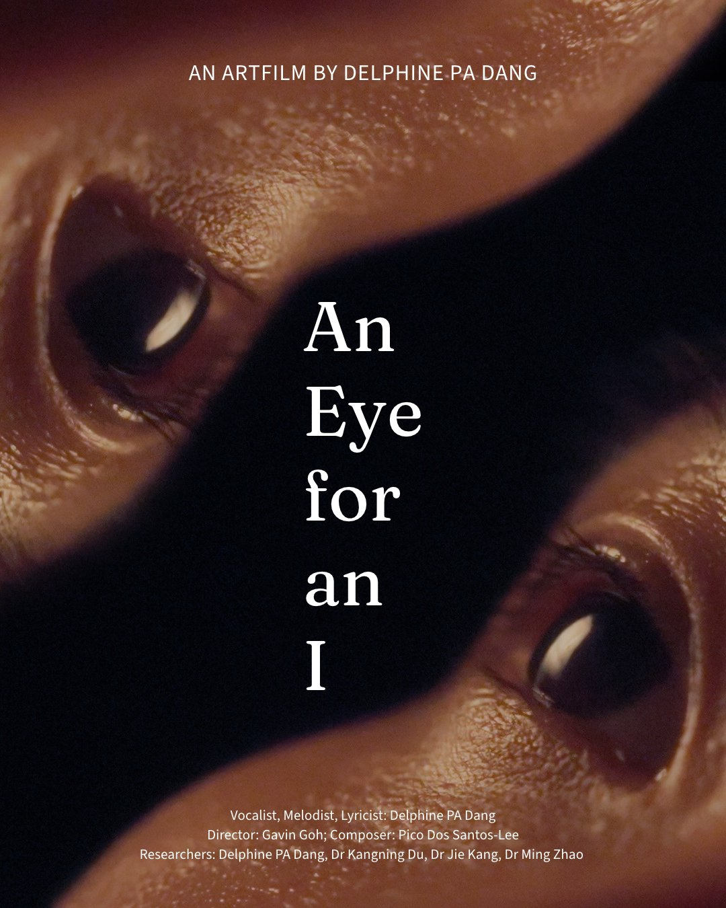
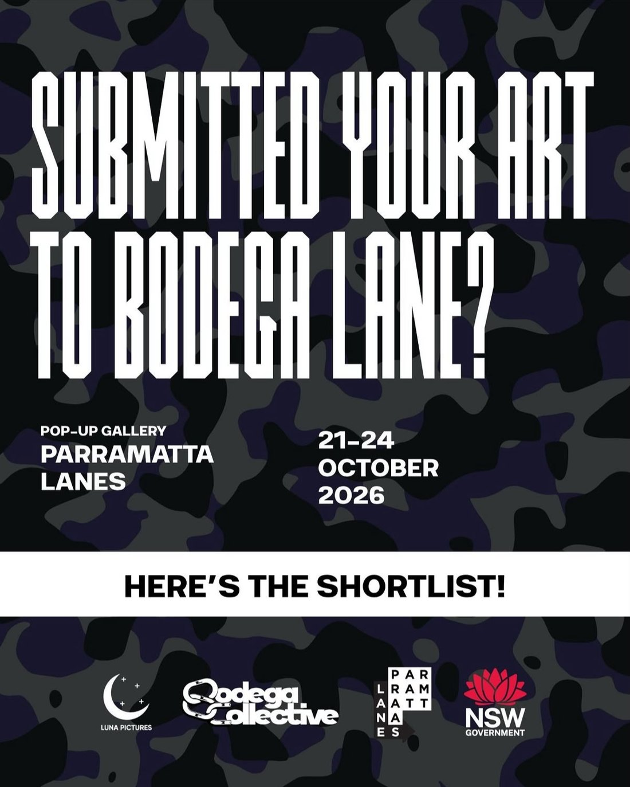
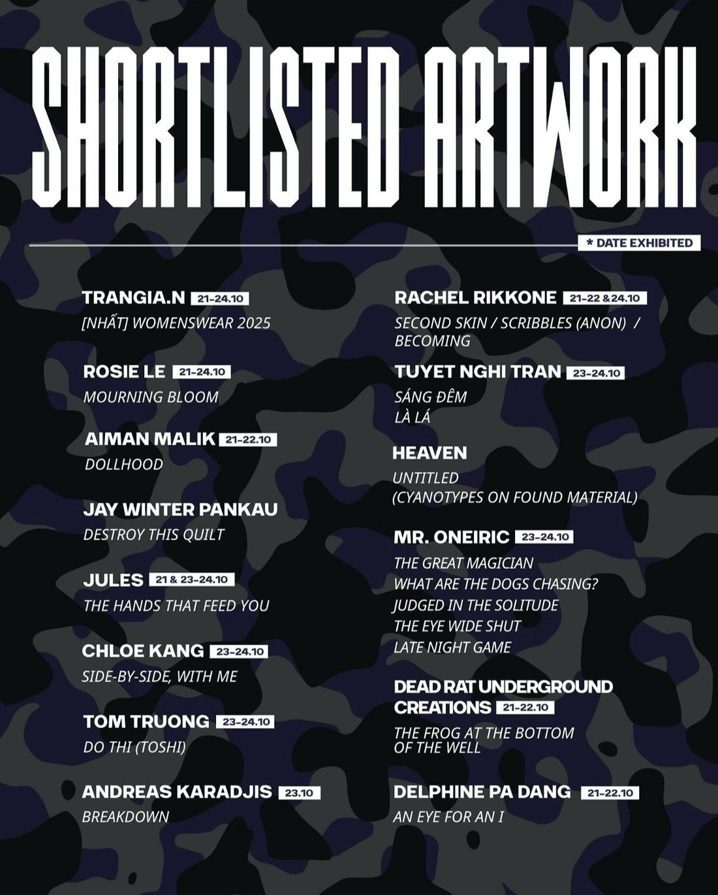
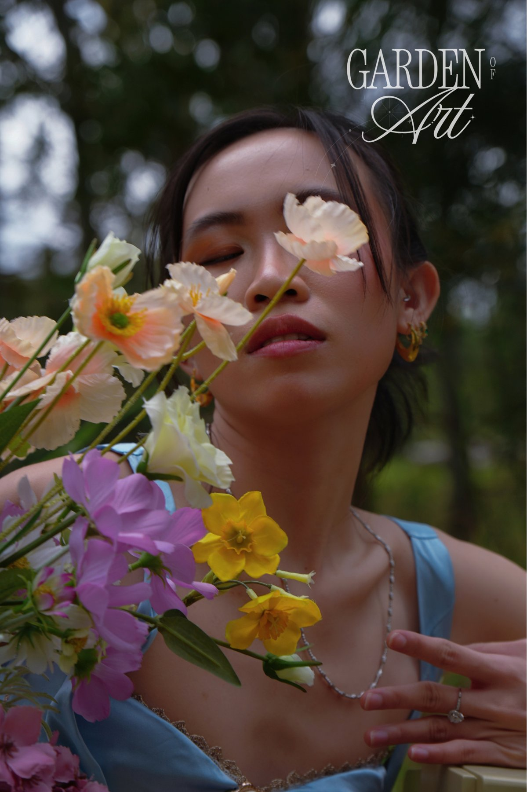
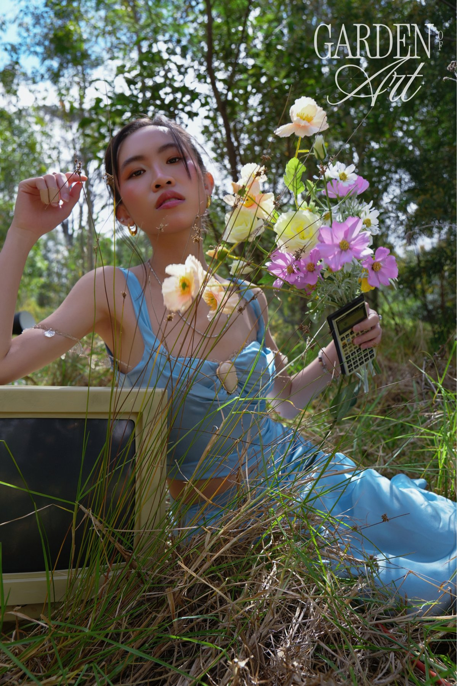

<!--
HOW TO ADD A WORK
Copy one ::: {.feature ...} block and change the picture, label, title and roles.
- YouTube video: data-video="ID" (the part of the YouTube link after "v=")
- Any other link (Instagram, Vimeo...): data-link="https://..."
- data-label changes the button text. Add .flip to put the picture on the right.
-->

## Film {#film}

::: {.feature data-video="ig204wgDkpE" data-label="Watch the film"}
{.poster fig-alt="Poster for An Eye for an I: two close-up eyes facing each other across a dark band."}

::: {.work-text}
[Art film]{.label}

### An Eye for an I

[Lead artist, lead researcher, co-composer and vocalist]{.roles}

My findings on large language models, translated into sound and image.

::: {.actions}
:::

::: {.shown}
Shown at the Charles Perkins Centre EMCR Symposium and the Parramatta Lanes pop-up gallery, Bodega Lane, 21–22 October 2026.
:::

::: {.exhibit-row}
{.exhibit fig-alt="Bodega Lane pop-up gallery poster: Parramatta Lanes, 21 to 24 October 2026, here's the shortlist."}

{.exhibit fig-alt="Shortlisted artwork list for Bodega Lane, including Delphine PA Dang, An Eye for an I, exhibited 21 to 22 October."}
:::
:::
:::

::: {.feature .flip data-link="https://www.instagram.com/p/DebRFCvElon/" data-label="Watch on Instagram"}
{.poster fig-alt="Poster for The Garden of Art: Delphine with eyes closed behind a bouquet of pastel flowers."}

::: {.work-text}
[Fashion film]{.label}

### The Garden of Art

[Executive producer, actor, opera singer and songwriter]{.roles}

::: {.actions}
[Listen to the song](#music){.text-link}
:::
:::
:::

<!-- When the Be My East video is online, add data-video="YOUTUBE_ID" after .feature below. -->
::: {.feature}
{.poster fig-alt="Poster for Be My East: two people sitting close together on the floor in a dim room, with festival laurels."}

::: {.work-text}
[Music video for Cameron Dies Twice]{.label}

### Be My East

[Editor, in collaboration with director Gavin Goh]{.roles}

::: {.honours}
- *Winner* Best Cinematography, Sony Catchlight Festival 2026
- *Nominee* Best Music Video, Canberra Short Film Festival
- *Nominee* Best Music Video, Catchlight Film Festival
:::
:::
:::

::: {.pair}
::: {.work data-video="2Bb65tu4R4k" data-label="Watch"}
{.thumb fig-alt="Still from a spec advertisement for Rhode Beauty."}

::: {.work-text}
[Spec commercial]{.label}

### Rhode Beauty

[Actress and producer]{.roles}
:::
:::

::: {.work data-video="qVR4P50DPDs" data-label="Watch"}
{.thumb fig-alt="Still from Delphine's visual film."}

::: {.work-text}
[Visual film]{.label}

### Visual film
:::
:::
:::

## Music {#music}

<!-- The waveform player: data-src is the audio file, data-peaks is the waveform shape. -->
```{=html}
<div class="song-card">
  
  <div class="song-body">
    <p class="label">Song for the fashion film</p>
    <h3>The Garden of Art</h3>
    <p class="roles">Lyricist, melodist and vocalist</p>
    <div class="player" data-src="audio/the-garden-of-art.mp3" data-title="The Garden of Art"
         data-peaks="[0.054,0.087,0.099,0.305,0.233,0.475,0.313,0.45,0.428,0.389,0.37,0.37,0.812,0.773,0.518,0.546,0.406,0.326,0.173,0.283,0.262,0.613,0.878,0.6,0.365,0.42,0.407,0.381,0.415,0.458,0.53,0.603,0.596,0.478,0.38,0.298,0.24,0.296,0.353,0.245,0.377,0.357,0.375,0.416,0.364,0.437,0.48,0.502,0.575,0.59,0.68,0.722,0.834,0.647,0.596,0.771,0.972,1.0,0.808,0.776,0.761,0.489,0.156,0.07,0.043,0.055,0.07,0.168,0.298,0.378,0.464,0.549,0.526,0.452,0.397,0.258,0.209,0.201,0.197,0.161,0.129,0.13,0.157,0.177,0.197,0.161,0.18,0.207,0.188,0.242,0.258,0.3,0.246,0.305,0.281,0.299,0.242,0.15,0.252,0.336,0.404,0.375,0.263,0.235,0.252,0.468,0.503,0.401,0.284,0.334,0.377,0.333,0.349,0.352,0.373,0.278,0.168,0.089,0.032,0.005]"></div>
  </div>
</div>
```

::: {.songs}
::: {.work .song data-video="ig204wgDkpE" data-label="Listen"}
{.cover fig-alt="Cover for An Eye for an I."}

::: {.work-text}
### An Eye for an I

Lyricist, melodist and vocalist
:::
:::
:::
